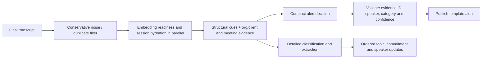

# Conversation alert pipeline

`MEETING_PIPELINE_MODE=legacy` remains the default during rollout. Experimental
`live` mode separates a compact, evidence-backed alert decision from detailed
classification and extraction.



## Why change the four-tier cascade?

The old alert path waits for embedding readiness, classification and retrieval,
then a second model's generated alert. Its per-session FIFO waits for the entire
previous evaluation. A slow request can delay every later alert; backlog shedding
can skip an alert altogether.

Live mode removes classification from the alert dependency chain. The decision
sees the raw utterance, earlier statements with speaker IDs, retrieved org facts,
meeting commitments, constraints and speaker states. It infers the semantic guards
from that context rather than waiting for a classifier's confidence gate.

The decision returns only `alertType`, `severity`, `confidence` and `evidenceId`.
Code checks that the reference actually exists, verifies speaker attribution for
self/team/client contradictions, enforces category roles and confidence floors,
and constructs an alert with quoted evidence and a category-specific suggestion.
It does not wait for generated headlines or suggestions.

The existing classifier runs concurrently and preserves all intent, tone, risk,
commitment type, exact extracted values, topic delta and identity fields. Alerts
publish before extraction and ledger/topic updates. State updates retain admission
order. Two evaluations overlap per session; an earlier stalled request cannot hold
up the second ready alert. Slots remain occupied through enrichment and ordered
commit, bounding the number of pending state updates.

## Organization evidence

For each utterance, the existing 768-dimensional embedding retrieves active
client decisions, applicable active org/client policies and client important points
in **one parameterized SQL round trip**. Each source retains its own top-two budget
and the existing similarity threshold. The in-session commitment ledger is searched
separately. Organization policies for a different client are excluded at preload
and query time.

Queries return evidence text alongside IDs and similarity, including matches
outside the bounded startup preload. A match no longer becomes an unusable
“preload miss” placeholder. Similarity selects evidence, not a contradiction verdict.
The decision must distinguish an actual conflict from a merely related statement.

Retrieval reports `ok`, `unavailable` or `not_configured`. Missing embeddings or
failed queries must not look like a complete search with no matches. Preloaded
constraints and recent speech remain available. Older facts without authorship
cannot be assigned to a particular speaker. Recent statements use speakerId when
userId is absent; two missing userIds do not establish identity.

## Coverage and lifecycle

All twelve alert categories remain in the decision rubric, with existing confidence
thresholds and routing. Agenda closeout stays with the existing meeting-end checks;
it cannot be emitted as an ordinary mid-meeting decision. Repeated speaker-state
patterns still use ordered classification updates, so those alerts can arrive later
than an immediate contradiction decision.

The prefilter drops empty/noise text, exact acknowledgments and exact normalized
duplicates. It preserves short negations, Devanagari, changed prices, currencies,
decimals and substantive statements starting with “okay”. Approximate similarity
can hide the very change a contradiction detector needs.

Inference uses the configured `GEMINI_TIER4_TIMEOUT_MS` (1500 ms by default), with a
local timeout race and correctly placed SDK abort signal in the new path. Closing
a session suppresses late decisions and state writes. This deadline does not cover
STT, retrieval, queueing or delivery. The legacy transport remains unchanged.

The $2 hard session cost cap and $1.60 warning gate remain. At warning level,
structural or retrieved evidence is required. Compact decisions on ordinary
substantive speech change the cost/coverage tradeoff from legacy classification
gating; compare cost per meeting along with precision and recall.

## Configuration

| Variable | Default | Purpose |
|---|---|---|
| `MEETING_PIPELINE_MODE` | `legacy` | `live` opts into compact decisions + parallel extraction |
| `LIVE_PIPELINE_CONCURRENCY` | `2` | Overlapping evaluations per session, clamped to 1–4 |
| `GEMINI_TIER4_MODEL` | Repo: `gemini-3.5-flash-lite` | Decision model / legacy final reasoner |
| `GEMINI_TIER4_TIMEOUT_MS` | `1500` | Decision inference deadline |
| `GENERALCOMPUTE_*` | Existing values | Detailed classification/extraction in both modes |
| `SPECULATIVE_ENABLED` | `false` | Legacy partial classification; unused in live mode |

The active deployment was verified separately: `larity-prod` runs in Mumbai,
`asia-south1-a`, and its worker currently configures `gemini-3.1-flash-lite`.
No VM/container configuration was changed and no code was deployed.

## Measured results (2026-10-23)

Synthetic probes ran through stdin in the existing Mumbai worker, with no saved
remote files and no real transcripts or organization records.

| Synthetic case | Compact decision | Full classification + generated alert |
|---|---:|---:|
| Revised delivery deadline | 950 ms | 2025 ms |
| Conflict with org policy | 1253 ms | 1914 ms |
| Safe scoped estimate | 1205 ms | 1545 ms |

Both variants returned the expected category in all three examples; the safe case
abstained. The compact decision returned 39–48 output tokens, versus 306–375 for
the combined response. The combined variant is retained as an evaluation control
(`LiveMeetingAnalyzer`), not the live runtime analyzer.

These are **model-call timings on three small examples**, not end-to-end alert
latency, a production p95, or a multilingual accuracy evaluation. The compact check
used a 3000 ms diagnostic cap; its observed calls fit under the normal 1500 ms cap,
but a broader p95 test is still required. A prior version with the full redundant
prompt missed two 1500 ms deadlines, which motivated the shorter decision rubric.

The new SQL also executed successfully against the deployed pgvector database
using nonexistent synthetic org/client IDs (110 ms including cold client setup,
no records returned). That verifies compatibility, not search latency under load.

Workstation checks were much slower than Mumbai and should not be used to select
production thresholds. The configured providers' tiny decision probes from Mumbai
were approximately 0.9–1.5 seconds. A faster hosted decision model such as Clef/Jev
is still worth testing behind `LiveAnalyzer`; neither is configured or benchmarked
here. It must consume the retrieved evidence and retain the same code-side checks.

## Validation and rollout

Metrics include `pipeline.retrieval_ms`, `pipeline.analysis_ms`, queue wait,
utterance-to-alert time, schema failures, decision timeouts and retrieval errors.
Trace payloads identify mode and phase durations. Finalizer/STT metrics cover time
before pipeline admission; utterance-to-alert alone is not speech-to-overlay time.

Replay labeled English/Hindi/Hinglish conversations, short corrections, revised
prices/dates, cross-speaker promises and org policy conflicts. Compare per-category
precision/recall, p50/p95 final-to-overlay latency, timeouts, backlog and meeting cost.
The feature remains opt-in until that evaluation passes.

```bash
# Compact decision, normal configured deadline:
bun --env-file=.env scripts/benchmark-live-pipeline.ts --decision
# Diagnostic cap only; does not change production configuration:
bun --env-file=.env scripts/benchmark-live-pipeline.ts --decision --timeout-ms=3000
# Combined-response comparison:
bun --env-file=.env scripts/benchmark-live-pipeline.ts --timeout-ms=10000
```
